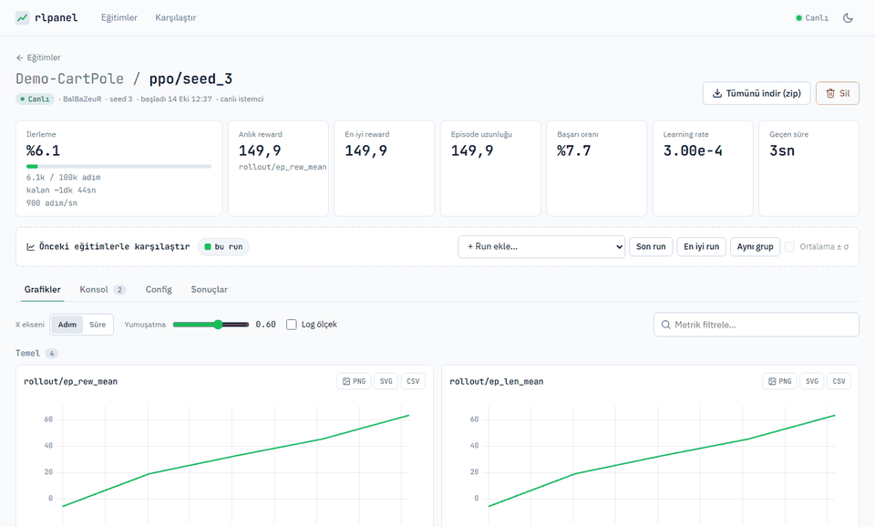
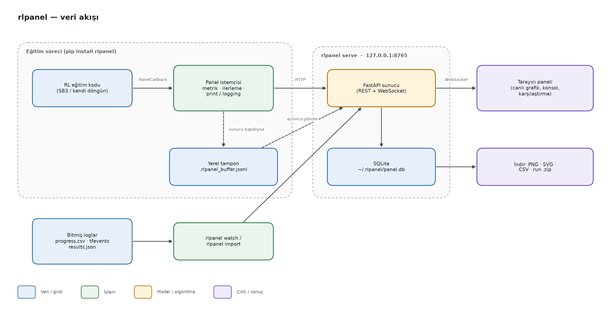
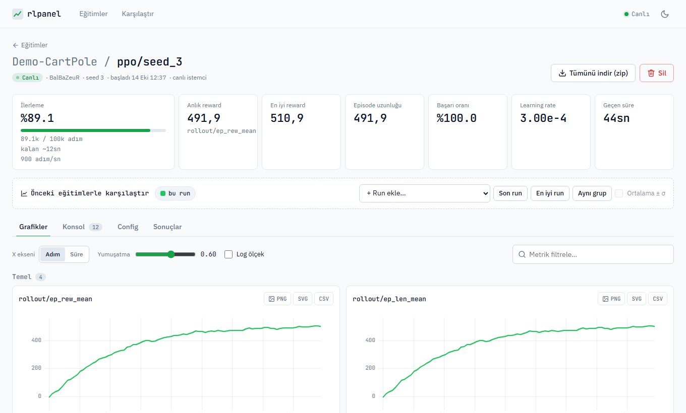
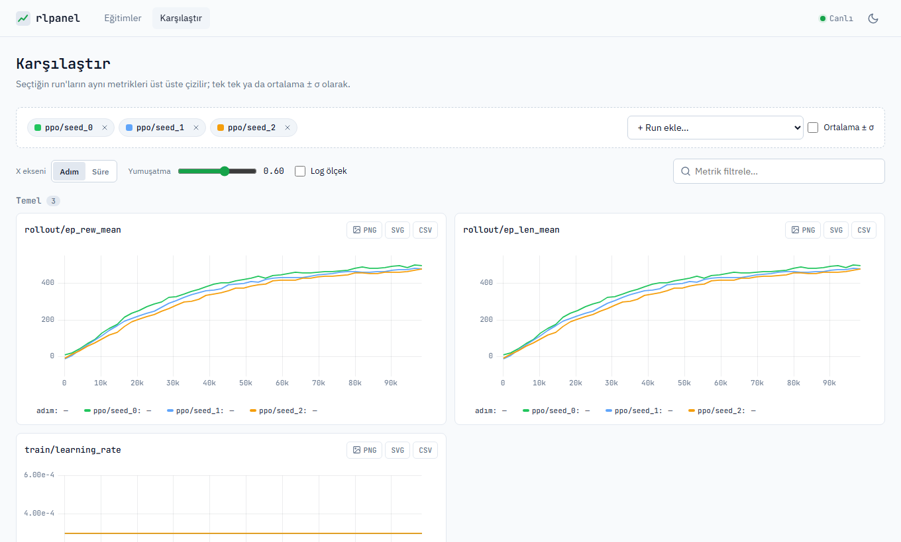
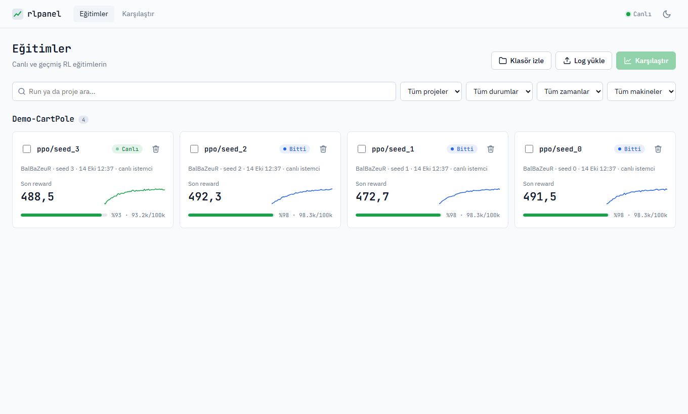

# rlpanel

**RL eğitimlerini terminal yerine tarayıcıda, canlı grafiklerle izleyen ve karşılaştıran yerel bir panel.**

Eğitim koduna tek satır (`PanelCallback`) eklenince tarayıcıda bir panel açılır. Panelde ilerleme yüzdesi,
anlık reward ve loglanan **her** metriğin grafiği ile canlı konsol bulunur. Bitmiş eğitimler sonradan
yüklenebilir, seed'ler üst üste karşılaştırılabilir, her grafik PNG / SVG / CSV olarak indirilebilir.
Amaç, MTA Yapay Zeka Merkezi'ndeki RL projelerinin (DroneTrackingRL, LunarRocket …) ortak izleme aracı olmaktır.



*Demo-CartPole PPO eğitimi sürerken panel: ilerleme %6 → %85, reward eğrisi ve kartlar canlı güncelleniyor.*

## Özet

| | |
|---|---|
| **Problem** | RL eğitim çıktısı terminalde akıp kayboluyor; seed'leri ve önceki deneyleri yan yana görmek zor. |
| **Yöntem** | Eğitim sürecindeki küçük istemci metrikleri HTTP ile yerel FastAPI sunucusuna yollar. Sunucu SQLite'a yazar ve WebSocket ile tarayıcıya yayınlar. Sunucu kapalıysa veriler yerel tampona yazılıp sonra gönderilir. |
| **Simülasyon / donanım** | Ortamdan bağımsız (Gymnasium / Stable-Baselines3 ya da kendi döngün). GPU gerekmez; Windows 11 ve Python 3.12 ile test edildi. |
| **Makale** | Yok (araç projesi). |

### Sistem mimarisi



Eğitim süreci yalnızca HTTP istemcisi içerir, sunucunun iç yapısını bilmez. `rlpanel serve` ayrı bir süreçtir
ve birden çok eğitimi aynı anda dinleyebilir. Bitmiş loglar (`progress.csv`, tfevents, `results.json`)
`rlpanel watch` / `rlpanel import` ile aynı veritabanına alınır.

## Seçilmiş sonuçlar

### Sonuç 1: Canlı eğitim sayfası

Bir run'ın üst kartları (ilerleme, anlık / en iyi reward, başarı oranı, learning rate, süre) ve metrik
grafikleri. Her grafiğin PNG / SVG / CSV indirme düğmesi vardır; konsol sekmesinde `print`/`logging` çıktısı akar.



### Sonuç 2: Seed karşılaştırması

Aynı deneyin üç seed'i (`ppo/seed_0..2`) üst üste çiziliyor. "Ortalama ± σ" seçeneği bunları tek bant hâlinde gösterir.



### Sonuç 3: Eğitimler listesi

Tüm projeler ve run'lar durumlarıyla (Canlı, Bitti, Çöktü, Durduruldu, Yanıt vermiyor) tek listede.



*Tüm ekran görüntüleri `scripts/demo.py` verisiyle, `plots/` klasöründe.*

## Kurulum

### Gereksinimler

- Windows 10/11, Linux veya macOS
- Python ≥ 3.10 (3.12 ile test edildi)
- GPU gerekmez; isteğe bağlı: `stable-baselines3` (`[sb3]`), `tensorboard` (`[tb]`)

### Adımlar

Başka bir projeye bağımlılık olarak eklemek için `pyproject.toml` dosyasına şunu yaz:

```toml
dependencies = ["rlpanel[sb3] @ git+https://github.com/BalBaZeuR0/RLpanel"]
```

Geliştirme için temiz bir makinede:

```bash
git clone https://github.com/BalBaZeuR0/RLpanel.git
cd RLpanel
python -m venv .venv && source .venv/bin/activate      # Windows: .venv\Scripts\activate
pip install -e ".[dev]"
python -m pytest -q -m "not slow and not e2e"           # kurulum kontrolü
```

Beklenen çıktı:

```
90 passed, 18 deselected in 21.14s
```

## Kullanım

### Kendi eğitiminde

```python
from rlpanel import Panel, PanelCallback

panel = Panel(project="Projem", run="seed0", config=cfg)      # panel yoksa açar, tarayıcıyı açar
model.learn(total_timesteps=100_000, callback=PanelCallback(panel))
panel.log({"eval/basari": 0.93}, step=model.num_timesteps)    # kendi metriğin
panel.result({"final": 0.93})                                 # Sonuçlar sekmesi
panel.finish()
```

Tek satırlık kısa yol: `model.learn(..., callback=PanelCallback(project="Projem", run="seed0"))`.
SB3 kullanmıyorsan `panel.log({...}, step=t)` ve `panel.progress(t, toplam)` yeterli.

### Hazır demoyu çalıştırma

```bash
python scripts/demo.py
```

Beklenen çıktı (tarayıcıda panel açılır; önce 3 bitmiş seed, sonra canlı akan 4. run):

```
Canlı demo: http://127.0.0.1:8765/#/run/4
adım 0: reward -6.3
adım 8192: reward 161.3
adım 16384: reward 289.6
...
```

### Komutlar

| Komut | Ne yapar |
|---|---|
| `rlpanel serve` | Paneli açar (http://127.0.0.1:8765) |
| `rlpanel serve --host 0.0.0.0` | Uzak makinelerden erişilebilir yapar |
| `rlpanel watch <klasör>` | SB3 `progress.csv` / tfevents / `results.json` dosyalarını canlı izler |
| `rlpanel import <dosya> --project P --run r` | Bitmiş eğitimin logunu yükler |

Hata olursa run **Çöktü**, Ctrl+C'de **Durduruldu** olarak işaretlenir. 30 sn boyunca veri gelmezse **Yanıt vermiyor** olur.
Sunucu kapalıysa veriler `.rlpanel/<proje>-<run>/.rlpanel_buffer.jsonl` dosyasında birikir ve sunucu açılınca otomatik gönderilir.

### Ortam değişkenleri

| Değişken | Etki |
|---|---|
| `RLPANEL_SERVER=http://ip:8765` | Başka makinedeki panele gönder |
| `RLPANEL_NO_BROWSER=1` | Tarayıcı açma |
| `RLPANEL_DISABLE=1` | Paneli tamamen kapat (testler, CI) |
| `RLPANEL_HOME` / `RLPANEL_DB` | Veri klasörü / veritabanı yolu (varsayılan `~/.rlpanel/panel.db`) |

## Sonuçları yeniden üretme

| Şekil | Komut |
|---|---|
| `assets/demo.gif`, `plots/canli_run.png`, `plots/karsilastirma.png`, `plots/ana_sayfa.png` | `python -m playwright install chromium && python scripts/readme_gorselleri.py` |
| `assets/architecture.png` | `python scripts/flowchart.py assets/architecture.json` |

Görsel betiği geçici bir veritabanı kullanır, `~/.rlpanel` dosyalarına dokunmaz.

## Proje yapısı

```
RLpanel/
├── assets/              # README görselleri (demo.gif, architecture.png + .json kaynağı)
├── docs/                # tasarım ve uygulama planı
├── plots/               # README ekran görüntüleri
├── scripts/
│   ├── demo.py          # demo verisi: 3 bitmiş seed + canlı run
│   ├── readme_gorselleri.py  # assets/ ve plots/ görsellerini üretir
│   └── flowchart.py     # mimari şemasını JSON'dan çizer
├── src/rlpanel/
│   ├── client.py        # Panel: run başlat, metrik/log gönder, tampon
│   ├── sb3.py           # PanelCallback (Stable-Baselines3)
│   ├── server/          # FastAPI uygulaması, SQLite deposu, içe/dışa aktarma, klasör izleme
│   └── web/             # derleme gerektirmeyen arayüz (uPlot)
├── tests/               # birim + e2e (Playwright) testler
├── pyproject.toml
└── README.md
```

## Atıf, lisans, iletişim

```bibtex
@misc{rlpanel2026,
  title  = {rlpanel: RL eğitimleri için yerel, canlı izleme paneli},
  author = {Öztürk, Emir},
  year   = {2026},
  howpublished = {\url{https://github.com/BalBaZeuR0/RLpanel}}
}
```

Lisans dosyası henüz eklenmedi, kullanım için iletişime geçin.
İletişim: [@BalBaZeuR0](https://github.com/BalBaZeuR0), MTA Yapay Zeka Merkezi.
